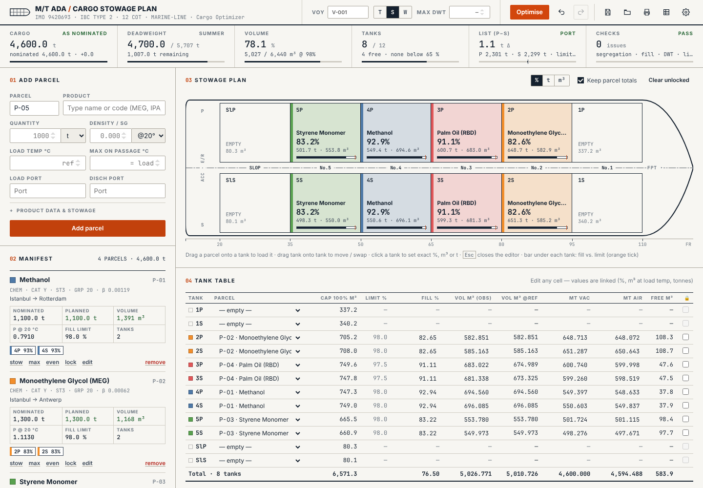

# Cargo Optimizer

Chemical tanker stowage planner for M/T X (IMO 9000001, IBC ship type 2, 12 cargo tanks).
No installation and no internet needed: open `index.html` in a browser.

Offline chemical tanker stowage planner and cargo optimiser: IBC Code ship type and segregation checks, filling limits, list and deadweight, with a C++ (WebAssembly) search engine.



## Optimisation goals (in order of priority)
1. Stow the **maximum cargo** (every tonne that doesn't fit is the heaviest penalty).
2. Use the **fewest tanks**, and leave the **least empty volume** in the tanks used (best fit).
3. **No slack tanks**: a tank filled below an adjustable threshold (default 65 %) is heavily penalised, so one tank at 70 % is chosen over two tanks at 35 %.
4. List: the part that can be corrected with empty ballast on the opposite side is penalised lightly, anything beyond that heavily; a ballast suggestion is given for the correction.
5. P/S pairs preferred, slop tanks as a last resort.

Hard constraints: one parcel per tank, a filling limit per parcel, no common bulkhead between incompatible parcels, locked tanks are never touched.

Algorithm: "minimal sufficient" tank subsets for each parcel (12 tanks → 4096 subsets, capacity DP) plus their P/S symmetric closures; the most constrained parcel goes first, branch & bound with a capacity lower bound. Typical run time 10–800 ms.

## C++ engine (v2)
The stowage search and the scoring done at every step (P/S moment, list during loading/discharge, slack, empty volume) are written in C++ in `engine/stowage.cpp`. They are compiled to WebAssembly and embedded in `js/engine-wasm.js`, so the app still runs by opening `index.html`, without internet. The UI, physics (VCF, filling limit) and compatibility stay in JavaScript.

- **Settings → Optimiser engine**: *C++ — deep search* (default, twice as wide a search), *C++ — standard search* (exactly the same plan as JS, ~25–40× faster), *JavaScript* (the previous engine).
- If WebAssembly can't be loaded, the planner falls back to the JavaScript engine automatically and shows a warning.
- **Consistency**: the C++ engine follows the same order of operations as JS and is compiled with FMA off (`-ffp-contract=off`); in standard search, JS, WebAssembly and the native build give bit-for-bit the same plan and score (`tests/engine-parity.js`).
- **Native build** (ship's computer, command line): `npm run build:engine -- --native` → `build/stowage` (input/output format at the top of `engine/stowage.cpp`).
- After changing the engine: `npm run build:engine` (needs clang + lld: `sudo apt install clang lld`). `js/optimizer.js` and `engine/stowage.cpp` are the same algorithm; a change to one must be made to the other too.

## Calculations
- **Density/VCF**: petroleum products ASTM Table 54B, lube oil / base oil ASTM Table 54D (15 °C), chemicals and vegetable oils the product's expansion coefficient β. The method can be changed by hand in the form.
- **Filling limit** = min(98 % × ρ(max temperature on passage) / ρ(loading temperature), 98 % × 1.54 / ρ).
- **Weight**: in vacuum or in air (WCF −0.0011).
- **Compatibility**: USCG 46 CFR 150 Figure 1 reactive group chart (exception pairs are shown as warnings), plus heat-sensitive products next to heated cargo (styrene, VAM, acrylonitrile…).
- **DWT**: T/S/W load line zone chosen by hand, optional draft-restricted DWT.

## Manual editing
- Click a tank → type %, m³ or tonnes; slider; step (0.5–100, t/m³/%); "Fill to limit", "Match pair", "Even out", "Empty".
- With **Keep parcel totals** on, a change in one tank is carried over to the other tanks of the same parcel, so the parcel total stays the same.
- Every cell in the tank table is editable; the parcel is picked from a drop-down.
- Drag a parcel onto a tank; drag a tank onto another tank to move or swap.
- Tank lock: Optimise leaves locked tanks alone. Adding a new parcel doesn't disturb the current plan (it only goes into empty tanks).
- **DWT**: if the nominations exceed the deadweight, Optimise warns and asks before scaling all parcels down proportionally (Cancel → full nomination, with a DWT overrun warning). The optimiser also takes the P/S imbalance of the current ballast into account.
- Undo / redo (Ctrl+Z / Ctrl+Y), autosave, save/open JSON, CSV, A4 landscape print (with signature blocks).

## Themes
Chart (paper, default) · Bridge (dark) · Night (red, night vision) · Auto.

## Tests
```bash
npm test          # calculation / optimiser tests + C++/JS parity test (Node)
npm run test:ui   # browser smoke test (installed Chrome, or CHROMIUM_PATH=/path/to/chromium)
```

## Desktop version (Tauri)
`npm run tauri build` — `dist-web/` is regenerated from `index.html`, `css/` and `js/` on every build (`npm run build:web`); don't edit it by hand.

> The regulatory data is a planning aid; the ship's Certificate of Fitness, the current IBC Code Ch.17/18, the USCG chart and the charterer's/shipper's instructions take precedence.
