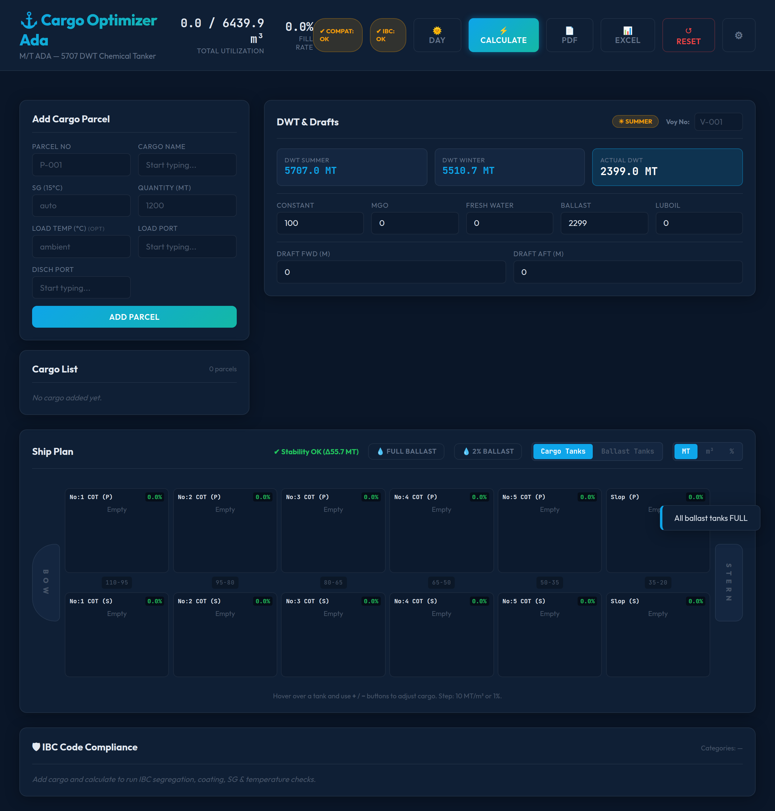

# Cargo Optimizer Ada

Stowage and segregation optimizer for M/T ADA — 5707 DWT chemical tanker, built around IBC Code compliance. Works fully offline.

## Features

- IBC Code segregation calculator (compatible / prohibited products)
- Tank allocation planner for 5707 DWT parcel layout
- Product compatibility matrix
- Coating / resistance checks
- Offline web app — no server, no account

## Tech

- Pure web UI (HTML/CSS/JS)
- **Tauri** (Rust) desktop shell — ~2 MB
- Data: chemical tanker product & IBC Code tables

## Download

- **Windows:** `CargoOptimizer_x64-setup.exe` (or `.msi`) from Releases
- **Linux:** `.deb` package

## Screenshot

## License

MIT — Recep Oğuz Yağbasan
